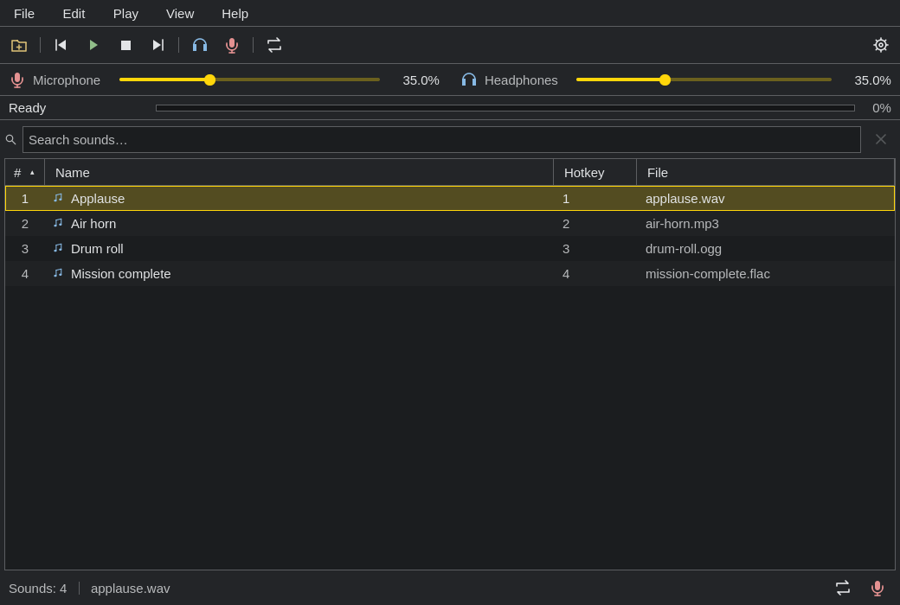

# Micpad

Саундборд для Linux / PipeWire с интеграцией Omarchy: позволяет слушать звуки и музыку без звонка,
а при записи выбранного физического микрофона другим приложением
отправляет туда эффекты вместе с голосом.
В списке устройств Discord, браузера или игры остаётся твой обычный микрофон.
Новые виртуальные микрофоны и выходы не создаются.

Установка из исходников описана в разделе [«Сборка и установка»](#сборка-и-установка).
После установки открой **Micpad** в меню `Super+Space` или запусти `micpad open`.

Интерфейс оформлен как ретро-панель Omarchy: моноширинные заголовки,
угловатые значки, клавиши в рамках и сегментированные ползунки. Окно разделено
на библиотеку, уровни громкости и проигрыватель. Основные действия доступны
в верхней панели, остальные — в меню ≡. В настройках → Appearance можно
включить **Sync colors with Omarchy** или выключить синхронизацию и выбрать
свою встроенную тему: **Micpad Dark**, **Gruvbox**, **Tokyo Night**,
**Catppuccin Mocha**, **Nord** или светлую **Paper**.
Палитра охватывает фон, панели, текст, выделение, меню, настройки и значки.
Выбор сохраняется и применяется без перезапуска и остановки звука.
При первом запуске синхронизация включается, если найдена палитра Omarchy;
на остальных рабочих столах сразу используется Micpad Dark.
Примеры встроенных палитр: [Tokyo Night](docs/theme-tokyo-night.png),
[Paper](docs/theme-paper.png).
Начальный размер окна — от 1040×700 при обычном размере текста.
Семейство шрифта во всём интерфейсе берётся из системного псевдонима
`monospace` через fontconfig — того же источника, который использует
`omarchy font current`. Текст, заголовки и проценты используют одну семью.
Размер следует настройкам Qt/GTK; для читаемости используется минимум
11 пунктов (15 пикселей для пиксельных шрифтов).
Высота строк, кнопок, полей, иконок и отступы рассчитываются по метрикам
текста. Смена семейства через Omarchy применяется к открытому приложению
автоматически: Micpad следит за конфигурацией fontconfig и заново разрешает
псевдоним. Изменение размера применяется вслед за уведомлением Qt.
В настройках → Appearance можно скрыть столбец с именами файлов.
Размер моноширинных заголовков следует тому же системному размеру текста.
В узком окне ползунки громкости располагаются друг под другом, а столбец
с именами файлов автоматически скрывается. Минимальный размер окна
учитывает текущий шрифт и оставляет место для строк таблицы.
Начальные 1040×700 задаются только при создании окна. Запуск, остановка,
имя звука и сообщения об ошибках не меняют размер окна и его минимальные
размеры: геометрия, выделенная тайлингом Hyprland, сохраняется.

1. Добавь аудиофайлы кнопкой с папкой, через меню ≡ или перетащи их в окно.
2. Выбери строку и нажми ▶, Enter или дважды щёлкни по ней: звук заиграет
   в текущих наушниках или динамиках. Звонок и даже подключённый микрофон
   для этого не нужны. Обычное воспроизведение всегда включает локальный звук.
3. Для отправки собеседникам выбери физический микрофон в настройках
   (кнопка в верхней панели), а в приложении для звонков выбери тот же микрофон.
   Когда программа начнёт его записывать, Micpad подключит отправку автоматически.
4. Схема на панели уровней показывает два направления: весь путь до микрофона
   подсвечивается при отправке в приложение записи, весь путь до наушников — при
   локальном прослушивании. На паузе ветки приглушаются. Подробный статус
   доступен по наведению. Начало или завершение звонка не перезапускает звук.
   Кнопка микрофона под таблицей играет только собеседникам, кнопка наушников —
   только тебе. Обычная кнопка ▶ запускает звук для тебя и собеседников.
   Для отправки только в микрофон нужна активная
   запись этого микрофона другим приложением.
5. Для клавиш из игры открой меню ≡ → «Горячие клавиши» → «Включить глобальные клавиши».

Кнопка ▶/Ⅱ и Пробел ставят на паузу и продолжают с той же позиции.
Позицию можно менять нажатием или перетаскиванием по шкале, в том числе
на паузе. Кнопки двойных стрелок и клавиши ←/→ перематывают на 5 секунд.
Рядом со шкалой показаны прошедшее и общее время. Пауза и перемотка
работают в обычном режиме и в обоих отдельных направлениях.

Поиск учитывает название звука и имя файла. Щелчок по заголовку столбца
сортирует таблицу; повторный щелчок меняет направление. Исходные номера
звуков и клавиши 1–9 сохраняются после поиска и сортировки. Правый щелчок
по строке открывает меню воспроизведения, переименования и удаления из списка.
Обычное воспроизведение всегда слышно тебе; для отправки без локального
звука используй кнопку «Только в микрофон». На панели есть два независимых
ползунка: «Микрофон» регулирует громкость эффектов для собеседников,
«Наушники» — громкость для тебя, в том числе отдельное прослушивание.
Громкость твоего голоса и системные уровни устройств не меняются.
Уровни можно менять во время воспроизведения. Один кубик — 5% громкости:
в каждой шкале 20 делений. Мышь и клавиатура переключают уровень по этим
делениям; проценты отображаются целыми числами. Старые дробные значения
при загрузке округляются до ближайших 5%.

| Клавиша | Действие |
| --- | --- |
| 1–9 | Отправить соответствующий звук из окна |
| Enter / двойной щелчок | Отправить выбранный звук |
| ↑ / ↓ | Выбрать предыдущую / следующую строку |
| Пробел | Запустить выбранный звук / пауза / продолжить |
| ← / → | Перемотать на 5 секунд назад / вперёд |
| Esc | Остановить воспроизведение и убрать соединения Micpad |
| Ctrl+O | Добавить аудиофайлы |
| Ctrl+F | Перейти к поиску |
| F2 | Переименовать выбранный звук |
| Delete | Убрать выбранный звук из библиотеки |
| Ctrl+Z / Ctrl+Shift+Z | Отменить / повторить изменение библиотеки |
| ? | Показать подсказку |
| Q | Закрыть приложение и остановить звуки |
| Ctrl+Alt+1–9 | Отправить звук из любого приложения после включения глобальных клавиш |
| Ctrl+Alt+0 | Остановить звук глобально |

Глобальные клавиши настраиваются отдельно: установщик сначала проверяет
конфликты и текущие ошибки Hyprland, затем создаёт резервную копию
`~/.config/hypr/bindings.lua`, добавляет помеченный блок и проверяет
результат через `hyprctl reload` / `hyprctl configerrors`.
При ошибке возвращает исходный файл. Без нажатия этой кнопки
настройки Hyprland не изменяются. Автозапуск не добавляется.
Для отмены глобальных клавиш удали только блок между
`-- BEGIN MICPAD SHORTCUTS` и `-- END MICPAD SHORTCUTS`
и выполни `hyprctl reload`, затем `hyprctl configerrors`.

## Как передаётся звук

У аналогового микрофона нет программного входа, в который можно записать
аудиофайл. Поэтому Micpad находит уже существующие связи
«физический микрофон → поток записи приложения» в PipeWire и добавляет
параллельные соединения своего обычного потока воспроизведения
`Stream/Output/Audio` к тем же входным каналам приложения. PipeWire смешивает
их. Твой микрофон продолжает идти по исходным соединениям.

Поток воспроизведения виден в графе PipeWire как поток программы,
но не появляется в списках микрофонов и звуковых выходов как устройство.
Он создаётся только для отправки звука. Когда включено локальное прослушивание,
Micpad добавляет соединения своего потока с левым и правым входными каналами
текущего устройства вывода по умолчанию. Повторного декодирования и отдельного
проигрывателя для этого нет: один декодированный звук и общий указатель
воспроизведения формируют два независимых канала с разными коэффициентами
громкости. Канал FL потока отправляется только в приложения записи,
канал FR — в оба канала наушников или динамиков. Автоматическое
перемешивание каналов этого потока отключено.
Голос микрофона в наушники не отправляется. При смене системного устройства
вывода Micpad переключает только свои соединения. Все они имеют
`object.linger=false`: сервер убирает
их при отключении клиента, в том числе при аварийном завершении.
Micpad удаляет только собственные соединения и поток.

Приложение не меняет устройства по умолчанию, профили карты, уровни
микрофона/динамиков, конфигурацию PipeWire/WirePlumber и не перезапускает
звуковые службы. При обнаружении mute физического микрофона подмешивание
в приложения прекращается, а локальная музыка продолжает играть. Отсутствие
или отключение микрофона также не мешает локальному прослушиванию.
Состояние проверяется раз в 350 мс. Кнопка «Стоп» выключает оба направления. Пауза сохраняет собственные
соединения Micpad и позицию, но выдаёт тишину в оба канала эффекта; исходный
голос продолжает идти напрямую. Перемотка меняет курсор PCM под блокировкой
аудиопотока, без повторного декодирования и пересоздания соединений.

## Ограничения и проверка

- Поддерживаются потоки PipeWire, включая программы через pipewire-pulse.
  Прямой захват ALSA в обход PipeWire не поддерживается.
- Для отправки в микрофон принимающее приложение должно уже его записывать.
  Это может быть звонок, проверка микрофона или обычная запись. Для локального
  прослушивания запись микрофона не нужна. В закрытый или неактивный поток
  записи звук не отправляется. Потоки, использующие другой
  микрофон, не получают эффекты. Для отдельного выбранного потока приложение
  после его пересоздания нужно выбрать снова, чтобы не подмешать звук чужому
  процессу с повторно использованным ID.
- Подмешиваются только DSP-порты `32 bit float mono audio`.
  Неподдерживаемый формат или отказ PipeWire отображается как ошибка.
- Для локального прослушивания используется текущее устройство вывода
  по умолчанию. Если оно отсутствует или его порты не поддерживаются,
  приложение показывает сообщение, а отправка в микрофон сохраняется.
  На многоканальном выходе используются фронтальные каналы FL/FR,
  чтобы не подавать эффект во все каналы, включая сабвуфер.
- Шумоподавление, эхоподавление и автоматическая чувствительность в
  голосовом чате могут убрать музыку или эффекты. При необходимости
  настрой их в самом чате. Micpad этого не делает.
- В новой библиотеке громкость эффектов по умолчанию — 35% для микрофона
  и наушников. При обновлении со старого общего ползунка прежний уровень
  сохраняется для обоих направлений без уменьшения в три раза.
  Сохранённые отдельные уровни округляются до ближайшего деления 5%
  без дополнительного ослабления. Уровень голоса не меняется.
- Одновременно отправляется один звук, новый заменяет предыдущий.
  Поддерживается повтор. Ограничения в 3 минуты больше нет: файл
  декодируется целиком без обрезки. Подготовка длинной записи занимает время.
  PCM хранится во временном файле в каталоге кеша приложения и отображается
  в память без накопления всего звука в `QByteArray`. Система может
  освобождать прочитанные страницы. На диске нужно около 11,5 МБ на минуту
  записи. Временный файл остаётся доступен только через открытый дескриптор
  и освобождается после остановки, закрытия или аварийного завершения.
  Тайм-аут декодера срабатывает после 45 секунд отсутствия новых данных,
  а не по общей длительности записи или подготовки.
- Библиотека хранит пути к оригиналам и не копирует файлы.
  Не перемещай оригиналы после добавления. Переименование в библиотеке
  и удаление из неё не изменяют сами аудиофайлы.
- Настройки и библиотека атомарно сохраняются в
  `~/.local/share/micpad/library.json`.
- При включённой синхронизации палитра читается из
  `~/.local/state/omarchy/current/theme/colors.toml`.
  Приложение отслеживает замену файла, каталога темы и символических ссылок;
  изменения любого цвета применяются сразу. При выключенной синхронизации
  изменения Omarchy не влияют на выбранную встроенную палитру.
  Если файлы Omarchy временно недоступны, используется сохранённая встроенная
  тема; при их возвращении включённая синхронизация возобновляется.
  Настройки оформления атомарно сохраняются в
  `~/.local/share/micpad/appearance.json`. Недостающие или ошибочные
  цвета заменяются корректными значениями. Скругление следует Hyprland.
  Видимость имён файлов действует до закрытия окна. По умолчанию интерфейс
  английский независимо от языка рабочего стола. В настройках → Language можно
  выбрать English или Русский без перезапуска. Выбор атомарно сохраняется
  в `~/.local/share/micpad/language` и используется при следующих запусках.
  Для разового запуска с другим языком: `MICPAD_LANGUAGE=ru micpad open`
  (предварительно закрой приложение). Шрифт продолжает следовать системе
  независимо от выбранной палитры.

Автотесты проверяют выбор маршрутов PipeWire, независимость двух каналов
громкости, mute, начало и завершение звонка во время воспроизведения,
декодирование записи длиннее трёх минут, повтор и освобождение временных данных.
Тесты настоящего QML покрывают поиск, сортировку, горячие клавиши, настройки,
смену шрифта, встроенных палитр и синхронизации Omarchy, сохранение выбора
между запусками и геометрии окна при
воспроизведении. Установщик глобальных клавиш проверяется с имитацией Hyprland.
Для тестов интерфейса используется offscreen-режим Qt; реальное подключение
к PipeWire и работу в голосовом приложении нужно проверять отдельно.

Быстрая проверка из обычного терминала:

```sh
micpad check --json
micpad open
# Добавь файл и нажми ▶: без звонка звук должен быть слышен тебе.
# В голосовом приложении включи проверку того же обычного микрофона:
# к текущей музыке должна подключиться отправка, и будут слышны голос и эффект.
# Нажми «Стоп», затем закрой Micpad: голос должен остаться.
```

Основной механизм использует документированные
[потоки PipeWire](https://docs.pipewire.org/page_tutorial4.html),
[граф с несколькими связями у порта](https://docs.pipewire.org/devel/page_overview.html)
и [соединения с привязкой к сроку жизни клиента](https://docs.pipewire.org/page_module_link_factory.html).

## Сборка и установка

Проект рассчитан на Omarchy / Arch Linux с PipeWire и Qt 6.
На других дистрибутивах нужен совместимый набор зависимостей; установщик
глобальных клавиш предназначен для Omarchy с Hyprland.

Зависимости для сборки и запуска в Arch Linux:

```sh
sudo pacman -S --needed base-devel qt6-base qt6-declarative qt6-multimedia qt6-svg qt6-wayland pipewire ffmpeg fontconfig python
```

Из корня клонированного репозитория:

```sh
bin/build
bin/test
bin/install-user
micpad open
```

`bin/install-user` устанавливает приложение в `~/.local/bin` и добавляет
ярлык в меню приложений. Каталог `~/.local/bin` должен быть в `PATH`.
Число потоков сборки можно задать через `MICPAD_BUILD_JOBS`.

Для системной установки через Arch-пакет: `bin/install`.
Для сборки пакета без установки: `cd pkgbuild && makepkg -f`.
Установка в профиль пользователя не требует root и не меняет звук.
Исходники находятся в `src/`, тесты — в `tests/`, рецепт Arch-пакета — в `pkgbuild/`.

Управление из скриптов:

```sh
micpad check --json
micpad list --json
micpad add /path/to/sound.wav --json
micpad play 1 --json
micpad stop --json
micpad pause --json
micpad resume --json
micpad seek 45 --json
micpad skill install --json
```

`add`, `play`, `stop`, `pause`, `resume` и `seek` обращаются к уже открытому Micpad через локальный
сокет текущего пользователя. Нумерация звуков начинается с 1.
`play` подтверждает принятие команды; дальнейшие ошибки декодирования
или подключения показываются в окне. `skill install` устанавливает
встроенную инструкцию для агента в `$CODEX_HOME/skills/micpad/`.

## Лицензия

[MIT](LICENSE). Компоненты интеграции с темой и языком Omarchy основаны
на шаблонах Omarchy / Omacut; авторство указано в исходниках и лицензии.
